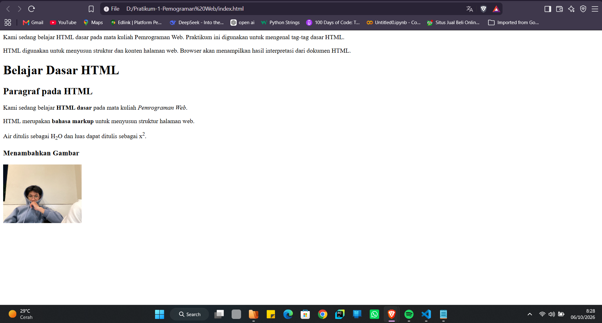
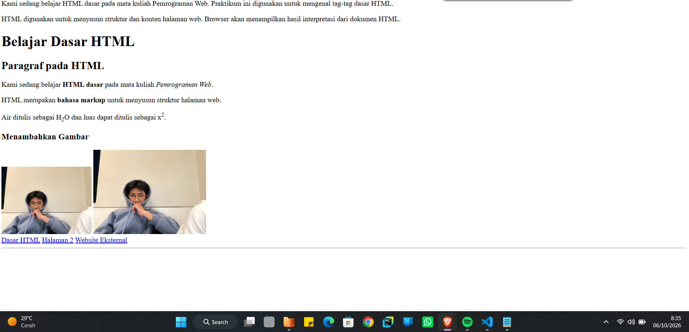
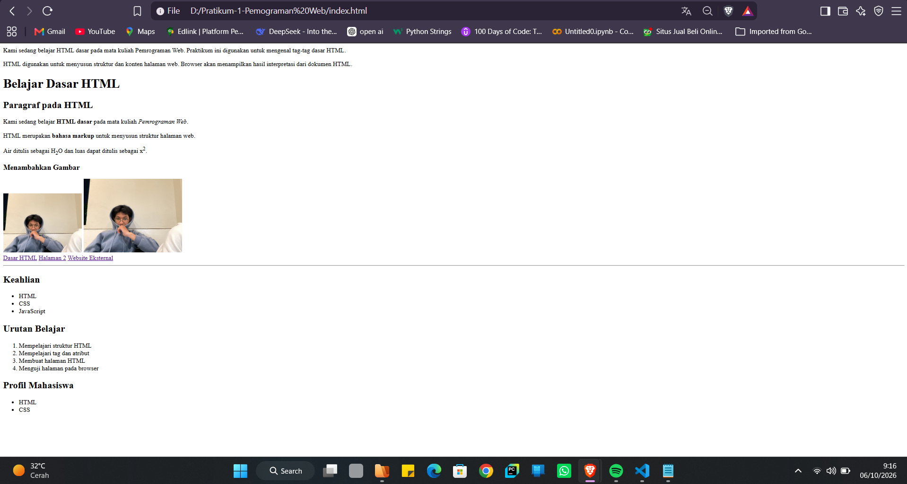
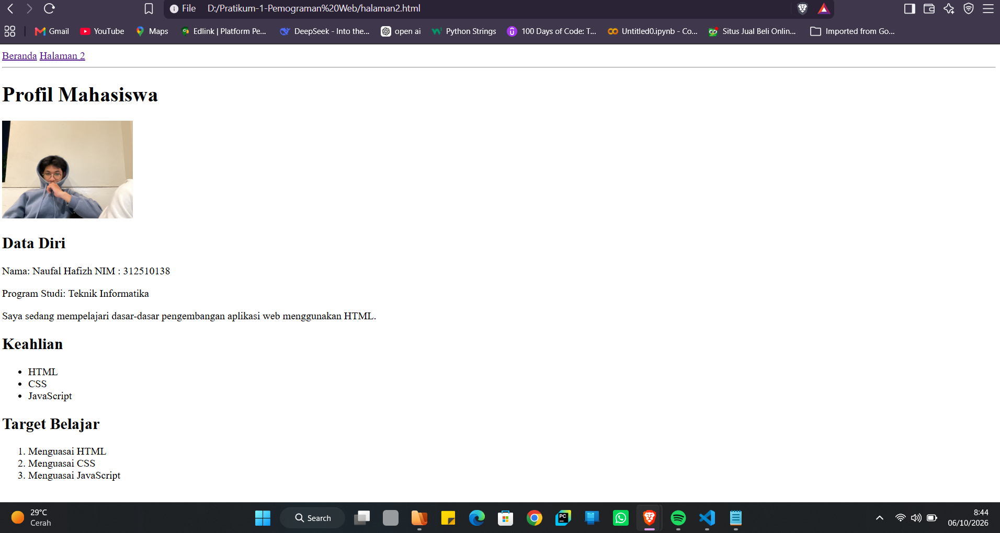

# Lab1Web

## Praktikum 1 - Pemrograman Web

### Identitas
- **Nama:** Naufal Hafizh
- **NIM:** 312510138
- **Program Studi:** Teknik Informatika

---

## Deskripsi

Praktikum ini membahas dasar-dasar HTML untuk membuat halaman web sederhana.
Pada praktikum ini dipelajari penggunaan paragraf, heading, formatting teks,
gambar, hyperlink, navigasi, serta list.

---

## Tujuan Praktikum

1. Memahami struktur dasar HTML.
2. Memahami penggunaan tag dan atribut HTML.
3. Membuat halaman web sederhana.
4. Membuat navigasi dan hyperlink antar halaman.
5. Menampilkan gambar dan informasi profil mahasiswa.

---

Hasil Praktikum

1. Paragraf
Pada tahap ini digunakan tag `
` untuk membuat paragraf pada halaman web.

Kami sedang belajar HTML dasar pada mata kuliah Pemrograman Web.
Praktikum ini digunakan untuk mengenal tag-tag dasar HTML.

2. Heading
Heading digunakan untuk membuat judul dan subjudul pada halaman web.
Tag yang digunakan antara lain <h1>, <h2>, dan <h3>.
<h1>Belajar Dasar HTML</h1>
<h2>Paragraf pada HTML</h2>
<h3>Menambahkan Gambar</h3>

3. Formatting Teks
Pada praktikum digunakan beberapa tag formatting seperti <b>, <i>,
dan <strong> untuk memberikan format atau penekanan pada teks.
<b>HTML dasar</b>
<i>Pemrograman Web</i>
<strong>bahasa markup</strong>

4. Subscript dan Superscript
Tag  digunakan untuk membuat teks menjadi subscript, sedangkan
 digunakan untuk membuat teks menjadi superscript.
Contohnya:
H2O
x2
Hasilnya adalah H₂O dan x².

5. Menambahkan Gambar
Gambar ditambahkan menggunakan tag  dengan atribut src, width,
alt, dan title.

Gambar yang digunakan adalah foto profil mahasiswa.

6. Membuat Navigasi dan Hyperlink
Navigasi dibuat menggunakan tag <nav> dan hyperlink menggunakan tag <a>.
<nav>
    <a href="index.html">Dasar HTML</a>
    <a href="halaman2.html">Halaman 2</a>
    <a href="https://www.google.com">Website Eksternal</a>
</nav>
Link tersebut digunakan untuk berpindah ke halaman utama, halaman kedua,
dan website eksternal.

7. Membuat Garis Horizontal
Tag 
 digunakan untuk membuat garis horizontal sebagai pemisah
antarbagian pada halaman.

8. Membuat Unordered List
Tag <ul> digunakan untuk membuat daftar yang tidak berurutan.
<ul>
    <li>HTML</li>
    <li>CSS</li>
    <li>JavaScript</li>
</ul>
Hasilnya berupa daftar dengan tanda bullet.

9. Membuat Ordered List
Tag <ol> digunakan untuk membuat daftar yang memiliki urutan.
<ol>
    <li>Mempelajari struktur HTML</li>
    <li>Mempelajari tag dan atribut</li>
    <li>Membuat halaman HTML</li>
    <li>Menguji halaman pada browser</li>
</ol>

alaman Profil Mahasiswa
Pada praktikum juga dibuat halaman kedua dengan nama halaman2.html.
Halaman tersebut berisi profil mahasiswa yang terdiri dari nama, NIM,
program studi, deskripsi diri, keahlian, target belajar, dan foto profil.
Data Profil
- Nama: Naufal Hafizh
- NIM: 312510138
- Program Studi: Teknik Informatika
Keahlian
- HTML
- CSS
- JavaScript
Target Belajar
1. Menguasai HTML
2. Menguasai CSS
3. Menguasai JavaScript

Navigasi Antar Halaman
Halaman index.html dan halaman2.html saling terhubung menggunakan
hyperlink.
<nav>
    <a href="index.html">Beranda</a>
    <a href="halaman2.html">Halaman 2</a>
</nav>

Dengan navigasi tersebut pengguna dapat berpindah dari halaman utama
ke halaman profil dan sebaliknya.

Struktur File
Lab1Web/
├── index.html
├── halaman2.html
├── images/
│   └── profil.jpg
└── README.md

Dokumentasi
Dokumentasi hasil praktikum berupa screenshot dari kode program dan
hasil tampilan halaman web dilampirkan pada repository ini.

Kesimpulan
Praktikum ini memberikan pemahaman dasar mengenai HTML dan cara
menggunakannya untuk membuat halaman web sederhana. Tag seperti paragraf,
heading, formatting teks, gambar, hyperlink, dan list dapat digunakan
untuk menyusun struktur serta isi halaman web.
Selain itu, penggunaan hyperlink dapat menghubungkan beberapa halaman
HTML sehingga membentuk navigasi sederhana dalam sebuah website.

## Dokumentasi Praktikum

### 1. Paragraf, Heading, dan Formatting Teks

Pada tahap ini dibuat paragraf, heading, serta formatting teks
menggunakan beberapa tag dasar HTML. dan digunakan tag `` dan `` untuk menampilkan
teks dalam bentuk subscript dan superscript.

### 2. Menambahkan Gambar

Pada tahap ini ditambahkan gambar menggunakan tag ``.

### 3. Hyperlink dan List

Pada tahap ini dibuat hyperlink, navigasi, serta daftar menggunakan
`<ul>` dan `<ol>`.

### 4. Halaman Profil

Pada tahap terakhir dibuat halaman profil mahasiswa menggunakan HTML.

